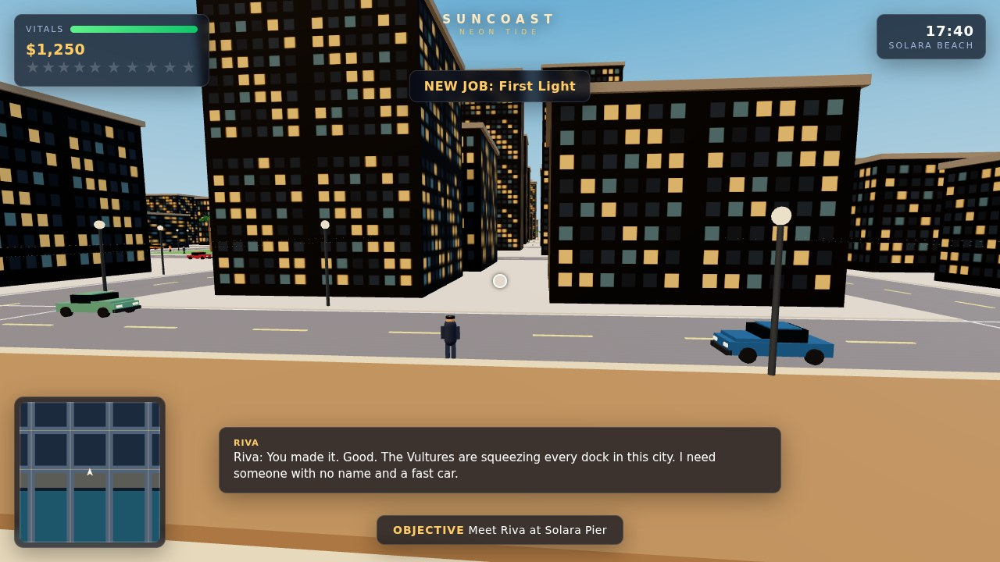
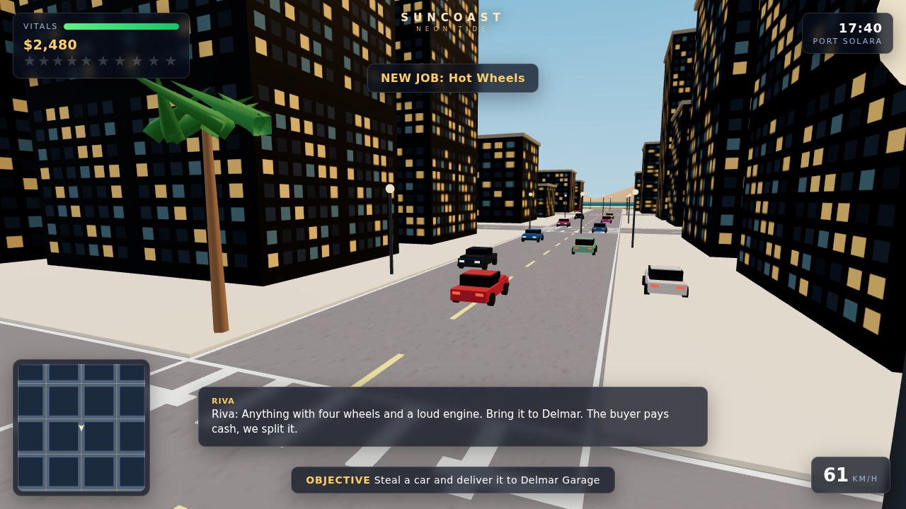
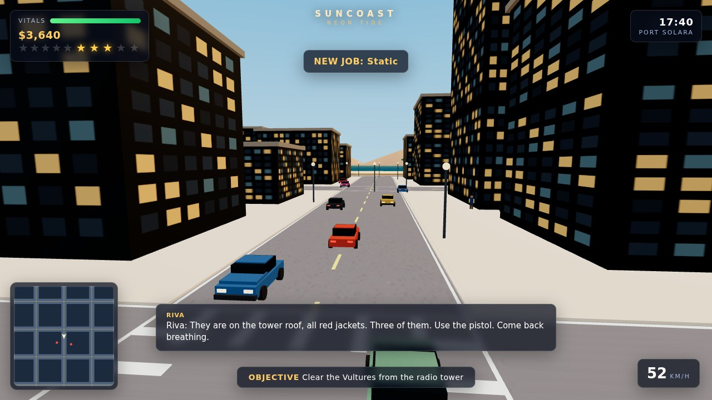
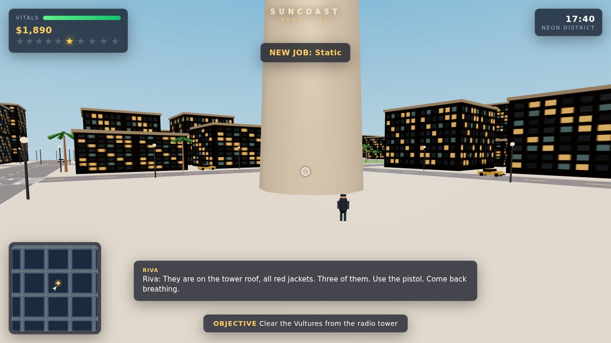

# Suncoast: Neon Tide

A small open-world crime game that runs in the browser. It is an entry for the
make.fun bounty `gta6-01` ("Make GTA 6"), written from scratch: an original city,
original characters, original car and mission design. No Rockstar assets, names or
maps are used.

The game is a static site. It loads with no build step, makes no network requests,
and vendors its only dependency (three.js r160) in `game/vendor/`.



## Play

```bash
node serve.ts          # serves game/ on http://localhost:8080
node serve.ts --port 12000
```

Open the printed URL, press **Enter Suncoast**, and click the canvas once to capture
the mouse. There is no build step and no package install.

### Controls

| Action | Key |
| --- | --- |
| Walk | W A S D / arrow keys |
| Sprint | Shift |
| Look | Mouse (pointer lock) |
| Shoot | Left click |
| Reload | R |
| Enter / exit a car | E |
| Pause | Esc |

In a car: W and S are throttle and brake/reverse, A and D steer, Shift is boost.

## What is in the city

- A 7x7 block grid with a hand-authored skyline, a central Needle tower, a beach
  boardwalk, palms, billboards and a bay with a low sun.
- Cars you can steal, arcade handling, parked cars, and lane traffic that brakes for
  you.
- Pedestrians walking block loops, and a pistol with tracers, muzzle flash and sparks.
- A five-star wanted meter, SCPD cruisers with flashing bars, officers who get out and
  shoot, and a siren.
- Four jobs from Riva: meet at the pier, deliver a stolen car, clear the tower, and
  lose the cops before going home. Each pays and advances the save.
- HUD with health, money, stars, clock, district, objective, speedometer, dialogue and
  a live minimap.
- Synthesised audio (engine, siren, gunshot, menu click) through WebAudio.
- One localStorage save slot (position, money, job progress, health).

## Screenshots

Taken from the running game with `python3 tools/shoot.py` (headless Chromium, real
canvas, real HUD).

| Street | Car |
| --- | --- |
|  |  |

| Wanted | Mission |
| --- | --- |
|  |  |

## Entry build

`main.ts` is the entry program from the `gta6-01` kit. It collects `game/` and the
four screenshots into a dossier:

```bash
MAKEFUN_OUTPUT_DIR=out node main.ts
```

The result is `out/dossier.json` plus the copied files. `out/` is disposable and
git-ignored.

## Layout

```
game/index.html             page shell, styles, HUD markup, import map
game/src/main.js            boot, input, frame loop, camera, save
game/src/world.js           sky, sun, sea, light, fog
game/src/roads.js           road grid, asphalt, crosswalks, lamps
game/src/city.js            towers, parks, palms, billboards, colliders
game/src/vehicles.js        car meshes, arcade physics, traffic, parked cars
game/src/pedestrians.js     walkers and hostile crew
game/src/player.js          on-foot controller and chase camera
game/src/police.js          cruisers, officers, squad AI
game/src/wanted.js          star meter and heat decay
game/src/missions.js        four jobs, markers, hostiles
game/src/combat.js          tracers, flashes, bursts, hitscan
game/src/hud.js             DOM overlay and dialogue
game/src/minimap.js         canvas minimap
game/src/audio.js           synthesised engine, siren, gunshot
game/src/save.js            localStorage slot
game/src/shots.js           deterministic poses for the screenshots
game/vendor/                three.js r160, vendored
screenshots/                the four entry screenshots
tools/shoot.py              screenshot capture
tools/playtest.mjs          CDP playtest of every job
tools/inspect.mjs           live state of a posed scene
serve.ts                    local static server
main.ts                     kit entry / dossier builder
```

## Notes

- `game/vendor/three.module.min.js` is three.js r160 under the MIT license. Two
  documentation URLs inside the minified build are written as plain text (and the
  XHTML namespace is built by string concatenation) so that every reachable module
  stays free of absolute http(s) references, as the bounty gate requires.
- `conversation-archive/` is the previous chat export kept for continuity. It is not
  part of the entry and is not referenced by the game.
- Suncoast is an original work. It is not affiliated with or endorsed by Rockstar
  Games; "GTA" is referenced only as the bounty theme.
